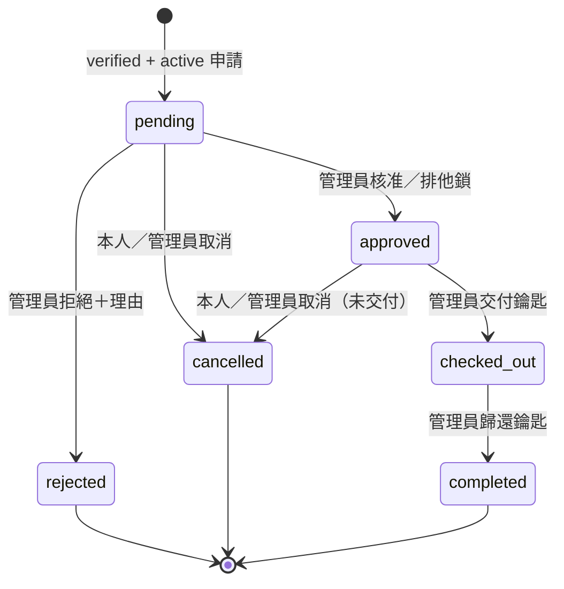
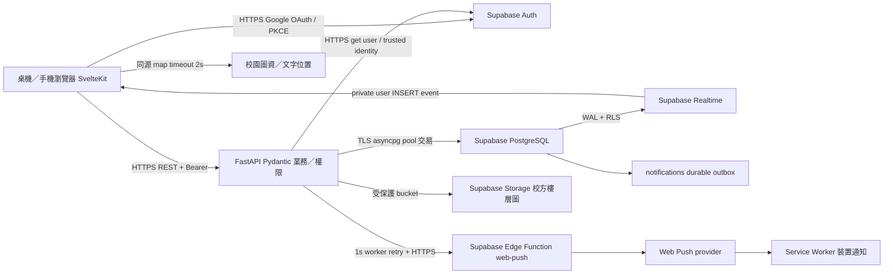
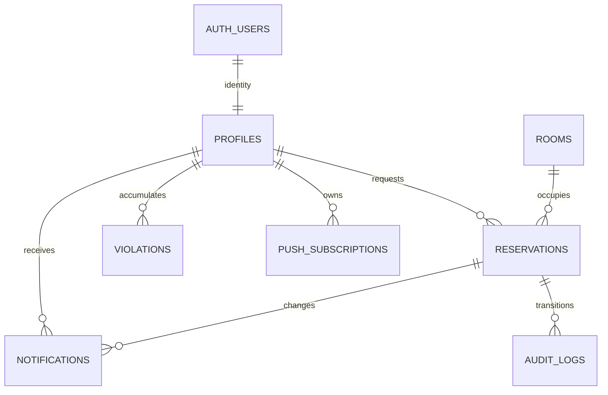

# 海大教室借用平台 — 系統規格

版本：1.3；初版規劃日期：2026-10-11；需求修訂日期：2026-10-13（Asia/Taipei）。初版先於應用程式實作建立；本次移除錄影用 Demo，進行真實服務串接與 Git 版本保存，正式部署依使用者決定暫緩。

發展者團隊：**林品希、陳佳昀、林良承、李曜年、侯屏嘉、洪于宸**。

## 1. 專案概述（What to build）

為國立臺灣海洋大學師生提供教室可用性查詢、即時／預約借用、週課表、教室位置、歷史與通知；管理員負責審核、鑰匙交還、違規及帳號管理。核心成功條件是資料庫無重複核准、每次寫入重新驗證資格、重要操作有可追溯紀錄，且桌機與手機皆可完成流程。

### 2026-10-13 開發狀態

- 錄影用的啟動器、專用占用資料、匿名初始化分支與 Demo 驗證腳本已移除；週課表的時間軸、非同步切換修正及前後週導覽保留。
- 本機示範資料庫與錄影工具已退役，私有恢復備份不進 Git；測試專用資料庫及 seed 仍供 CI 使用，不匯入真實 Supabase。
- 真實 Supabase／Google 先在本機連接與驗證。公開查詢仍免登入，但登入與借用要求真實校園 Google 身分；缺少 Auth 設定不得默認成可登入環境。
- 目前無正式伺服器及網域；依使用者決定暫緩正式部署，不能把本機串接或 CI 通過記為正式 HTTPS／全部 NFR 驗收完成。

### 決策與假設

- 固定棧採 **SvelteKit 2 / Svelte 5 + TypeScript + Tailwind CSS、FastAPI + Pydantic、Supabase**。第 3 節的 Firebase 選項與第 2 節固定 Supabase 衝突時，以固定項為準。
- Supabase PostgreSQL 的關聯、交易、GiST range exclusion、RLS 比 NoSQL 更適合重疊時段一致性；Auth、Storage、Realtime、Edge Functions 共用同一 BaaS。FastAPI 為唯一業務寫入入口，SvelteKit 不另寫業務 API。
- 使用 SvelteKit 靜態 SPA，FastAPI 提供 JSON API，反向代理同一 HTTPS 網域。內網工作平台不需 SEO；此方式少一個 Node 生產服務，職責明確。開發 localhost HTTP 是唯一例外，上線禁止 HTTP。
- 校方教室清單與樓層圖尚待核實。示範教室在 UI 明確標示，不能宣稱座標已獲校方確認；欄位支援精確經緯度、樓層、位置文字與校方確認旗標。正式圖資及 Supabase／Google OAuth 外部服務驗收仍為上線關卡。
- 依 2026-10-12 新需求，校園身分以 Supabase 驗證的 Google 帳號與精確信箱網域 `email.ntou.edu.tw` 為準，取消名冊比對前置條件。證號仍須填入 6–16 位英數，作為校園證件識別及唯一欄位；此格式不證明證號真實所有權，校園歸屬證明來自 Google 校園信箱。使用者不可自填角色或 verified。
- 即時借用指開始時間接近現在的申請，仍需管理員審核。開始時間不得早於現在 5 分鐘以上；預約最多 90 日，每筆 30 分鐘到 8 小時，開放 08:00–22:00，同日。時間儲存 UTC，輸入／顯示 Asia/Taipei，區間一律左閉右開 `[start,end)`。
- pending 允許競爭申請，不保證取得教室；approved 和 checked_out 占用時段。核准發生衝突回 409。completed 保留歷史、cancelled/rejected 釋放。
- 違規達 3 點自動停權；任何有效停權都禁止新申請和核准，管理員可恢復資格，恢復時須清除或調整未結案違規。未完成借用由管理員決定取消，避免自動遺失鑰匙責任。
- 本版僅提供 Google OAuth，不接收或儲存平台密碼；Google 密碼由 Google 處理，Supabase 管理 OAuth session。NFR-011 的密碼雜湊要求在平台無密碼模型下以「不接收／不儲存密碼」驗收，傳輸仍需 HTTPS。
- 新的 Google-only 要求取代 NFR-009 原有平台密碼登入提示。平台改明示「請使用學校 Google 帳號」、「登入已失效」或「請完成基本資料」，不洩露其他使用者個資；Google 端的帳號／密碼提示由 Google 控制，不能虛報仍測試平台密碼錯誤。
- 推播包含在線 Supabase Realtime 以及使用者授權後的背景 Web Push。不得把 OS 投遞成功和事件發出混為一談：NFR-005 的驗收測量交易提交到 Realtime 接收／Web Push provider 接受事件 <3s；離線裝置接收取決於網路和作業系統。

## 2. 主要功能與系統行為（Features & Behavior）

### 角色

訪客可查詢教室、時段、週課表、地圖。借用人先用學校 Google 帳號登入，首次使用再提供姓名、電話、系所與證號；email 只取伺服器驗證身分，不接受表單修改。完成基本資料及校園 Google 驗證後，可申請、查歷史、取消本人尚未領鑰匙的申請，接收通知。管理員角色僅由受信任部署人員設定，不能從 user_metadata 授權；可審核、調整狀態、記錄鑰匙、管理停權與違規。

### 狀態機



不提供任意跳躍式狀態改寫。拒絕需理由；交付與歸還時間、操作人保存於 reservation 與 audit_logs。相同 request_id 的申請重送回同一筆，重複交還回 409，非法轉移回 409。歷史清單分頁並依最近更新排序。

### 介面

查詢頁有日期、起迄時段、系館、容量／設備、列表與週課表切換。教室詳情包含可用性、設備、位置文字與地圖、申請表。其他路由為我的借用、通知中心、登入／註冊、帳戶驗證及管理台。管理台提供待審、所有紀錄、使用者及違規操作。UI 顯示送出中、成功、空資料、網路錯誤與重試，按鈕防重送但一致性仍由 DB 保護。

採校園白底、海洋深藍與青綠、清楚的文字與線條、可比較的教室資訊列；避免行銷型大數字和裝飾圖表。中文系統字體免網路字體阻塞；可以自託管子集字體，但本版不依賴 emfont。新增 GSAP 處理頁面進入、查詢結果／狀態提示及元件互動的短動畫，保留既有設計 token。只動畫 transform／opacity，約 160–280ms；尊重 prefers-reduced-motion，避免動畫延後查詢結果與操作可用時間。元件卸載／頁面切換須 revert context／matchMedia，不留 tween 或 event listener。圖資採同源輕量 SVG 校園示意圖（不是官方樓層圖）及數值座標點，不依賴第三方地圖圖磚；確保 2s timeout 和文字降級可測。

## 3. 系統架構圖與資料流（System Architecture & Data Flow）



### 3.1 學校 Google 註冊與身分驗證

前端用 Supabase `signInWithOAuth({ provider: 'google' })` 啟動 PKCE，callback 交換 code 為 session。Google 帳號選擇器可帶 `hd=email.ntou.edu.tw` 作提示；它不是授權判斷。callback URL 必須在 Supabase Redirect allow list，Google OAuth client 只設在 Supabase provider 設定，不放前端或 Git。

FastAPI 每次透過 Supabase `get user` 驗證 Bearer，檢查伺服器回傳的 Google provider／identity、已確認 email 與精確網域。不能相信 user_metadata、瀏覽器自行傳入 email／provider／verified，不能接受 `@mail.ntou.edu.tw`、`@gmail.com` 或 `@email.ntou.edu.tw.evil.example`。Supabase 端停用 Email/password provider，並提供 before-user-created hook 限制新身分為校園 Google；即使 hook 未設定，FastAPI 仍拒絕不符身分存取或建立 profile。

身分驗證還要求 Google identity 的 email_verified 為 true 且 identity email 與 Auth email 相同。在 Supabase 成功驗證同一 Bearer 後，解析該已驗證 token 的 sub／amr，要求 sub 等於 Auth UUID 且 amr 含 oauth，拒絕已有 Google 連結但實際使用 password／OTP 登入的 session；缺失或格式錯誤一律拒絕。Supabase refresh 由原 session 計算 AAL／AMR，保留 OAuth 方法，因此更新 token 不放寬此條件。這不是自行跳過簽章驗證：Auth get-user 成功是解析前提。

AMR 只表示 OAuth 類型，沒有 provider 名稱，因此另外要求可信 app_metadata.providers 與 identities 只含 Google，拒絕既有多 provider 帳戶，避免 primary provider 是 Google、但當次以其他已連結的 OAuth provider 登入。既有多 provider 帳戶須由維運核實轉換，不自動刪除或合併歷史資料。

首次 Google session 沒有 profile 是正常 onboarding：身分 API 回 onboarding_required，使用者补齊資料後由 FastAPI 原子建立 borrower profile 與 audit，email 及 UUID 只取已驗證身分。同一 UUID 重試不得刪除 Auth identity、覆寫角色或重複建立；不同 UUID 搶用同一證號回 409。資料庫暫時失敗可在同一 session 安全重試，不需原版人工 Auth/profile 孤兒補建。既有非 Google／非新網域帳戶保留歷史資料，但無法再借用；維運須核實本人後處理轉換，不自動合併或刪除。

### 3.2 業務資料流

1. Google OAuth／PKCE → FastAPI 驗證校園 Google 身分 → 首次基本資料 onboarding → borrower profile；不再由 FastAPI 建立 email/password Auth 帳號或查名冊。
2. 每個保護 API 用 Supabase get-user 驗證 Bearer 並重新查 DB profile，權限不依賴前端或過期 role claim；Google session 刷新仍由 supabase-js 管理。
3. 申請交易先 `SELECT profiles ... FOR UPDATE`（與停權更新共用鎖），確認 active/verified/違規，再插入 pending。寫 audit 和 notification 同一交易，任何一步失敗全部 rollback。
4. 審核鎖定 reservation、借用人及 room，確認角色和合法狀態；核准更新由 GiST 排他約束再防守。鎖等待有 timeout，映射成 409/503 可重試，不能返回假成功。
5. 通知 row 在同一交易持久化，Realtime 隨 WAL 發出。背景 worker 從 DB 領取未發送訊息，呼叫 Edge Function；失敗保留 attempts/error/next_attempt_at，指數退避且可在通知中心補讀。前端 2s 補讀與重新連線補讀防止漏事件；不暴露其他人的通知。
6. Storage 只存校方樓層圖；private bucket 與管理員上傳策略，公開顯示用有限時 signed URL；無校方圖時同源 SVG＋位置文字仍可使用。

本機真實 PostgreSQL 驗證 SQL 與 HTTP API；Supabase Auth 及 Push 的測試使用 HTTP transport fixture，不在生產提供測試登入或信任任意 token。正式 Supabase 端到端驗收另外執行。

## 4. 資料庫結構（Database Schema / ERD）



| 實體                 | 核心欄位與限制                                                                                                                                                                                                                                                |
| -------------------- | ------------------------------------------------------------------------------------------------------------------------------------------------------------------------------------------------------------------------------------------------------------- |
| profiles             | id UUID=auth.users.id, name, email UNIQUE, phone, department, institutional_id UNIQUE, role CHECK borrower/admin default borrower, verified false, suspended false, created_at                                                                                |
| institutional_roster | 既有部署保留的舊名冊表；新版認證流程不查詢，避免破壞既有資料；不授予 client 存取                                                                                                                                                                              |
| rooms                | id UUID, code UNIQUE, name, building, floor, capacity>0, equipment text[], latitude/longitude、map_x/map_y、location_text、location_verified、active                                                                                                          |
| reservations         | id UUID, user_id FK, room_id FK, starts_at/ends_at timestamptz, purpose, attendees>0, mode immediate/scheduled, status CHECK, decision_reason, reviewed_by, key_handed_at/key_returned_at, request_id UUID, UNIQUE(user_id,request_id), created_at/updated_at |
| violations           | id UUID, user_id FK, reservation_id optional FK, points 1–3, reason, resolved false, created_by FK, created_at                                                                                                                                                |
| notifications        | id UUID, user_id FK, reservation_id optional FK, title, body, read_at, created_at, delivered_at, attempts, next_attempt_at, last_error；同一交易的 durable outbox                                                                                             |
| push_subscriptions   | id UUID, user_id FK, endpoint UNIQUE, p256dh/auth keys，僅 HTTPS 合法 push provider 端點，不接受內網／任意 URL                                                                                                                                                |
| audit_logs           | id bigint identity, actor_id FK, action, reservation_id/user target, old/new status, created_at；append-only，無密碼與敏感 payload                                                                                                                            |

`btree_gist` 排他約束：`EXCLUDE USING gist (room_id WITH =, tstzrange(starts_at,ends_at,'[)') WITH &&) WHERE (status IN ('approved','checked_out'))`。這是跨 API、多 worker、直接 SQL 都不能繞過的最後防線。索引：reservation(user_id,created_at DESC)、room_id/starts_at、notifications(user_id,created_at DESC)、未送 outbox partial、violations(user_id) WHERE NOT resolved。資料表啟用 RLS；瀏覽器只讀本人 profile、notification，業務資料由 FastAPI 回應。以最低權限 backend role 讀寫應用 schema，不可 DDL；migration role 與應用 role 分開，service secret 只存在後端／Edge Function。外部角色不能 UPDATE role/suspended/verified 或呼叫內部函式。

## 5. API 規格書（API Endpoints）

Prefix `/api`；JSON UTF-8；UUID；時間 ISO8601 必須附 timezone。驗證錯誤 422；未登入 401；越權 403；無資料 404；衝突 409；速率限制 429；外部服務失敗 503。錯誤格式 `{ "detail": "可理解的中文說明" }`。保護路由用 `Authorization: Bearer <Supabase access_token>`。

| 方法／路由                      | Request／Response                                                                         | 權限                                          |
| ------------------------------- | ----------------------------------------------------------------------------------------- | --------------------------------------------- |
| GET /health                     | `{status:"ok"}`；readiness 需 DB 可連                                                     | 公開                                          |
| GET /config                     | `{supabase_url,supabase_publishable_key,vapid_public_key,demo_data}`（無 secret）         | 公開                                          |
| GET /auth/identity              | `{email,onboarding_required,profile?}`；email 只來自驗證身分                              | 校園 Google Bearer；尚無 profile 也可查       |
| POST /auth/register             | `{name,phone,department,institutional_id}` → 201 Profile；同一身分重試回原資料，不改 role | 校園 Google Bearer，限速；首次資料 onboarding |
| POST /auth/login                | 403 `{detail:"請使用學校 Google 帳號登入"}`                                               | 舊密碼入口停用，不呼叫 password grant         |
| GET /me                         | Profile（僅本人聯絡資訊）                                                                 | 已登入                                        |
| POST /me/verify                 | `{institutional_id}` → Profile；證號須符合本人已填資料，Google／校園 email 不符 403       | 本人；無名冊依賴                              |
| GET /me/eligibility             | `{eligible,verified,suspended,violation_points,reason}`                                   | 本人                                          |
| GET /rooms                      | 可選 building/capacity/equipment；`{items:[Room]}`                                        | 公開                                          |
| GET /rooms/availability         | `start,end,building?,capacity?,equipment?` → `{items:[Room + available]}`                 | 公開                                          |
| GET /rooms/{id}/schedule        | `start,end` 最大 7 天 → `{items:[{id,starts_at,ends_at,status}]}`；無借用人／用途         | 公開                                          |
| POST /reservations              | `{room_id,starts_at,ends_at,purpose,attendees,mode,request_id}` → 201 Reservation         | 已驗證 active 借用人                          |
| GET /reservations               | `limit(1..100),offset,status?` → `{items,total}`；本人或管理員完整列表                    | 已登入                                        |
| PATCH /reservations/{id}/status | `{status,reason?}` → Reservation                                                          | 管理員；本人僅 cancelled                      |
| GET /admin/users                | `limit,offset` → `{items,total}`                                                          | 管理員                                        |
| PATCH /admin/users/{id}         | `{suspended:boolean}` → Profile                                                           | 管理員；即時生效，不接受 role                 |
| POST /admin/violations          | `{user_id,reservation_id?,points,reason}` → Violation                                     | 管理員                                        |
| PATCH /admin/violations/{id}    | `{resolved:true}` → Violation                                                             | 管理員                                        |
| GET /admin/violations           | `user_id?,limit=50,offset=0` → `{items,total}`；limit 1–100                               | 管理員；穩定排序，舊未結案紀錄可分頁讀取      |
| GET /notifications              | `limit,offset` → `{items,total}`                                                          | 本人                                          |
| PATCH /notifications/{id}/read  | `{}` → Notification                                                                       | 本人；非本人 404                              |
| POST /push-subscriptions        | 標準 PushSubscription JSON `{endpoint,keys:{p256dh,auth}}` → 201                          | 本人                                          |
| DELETE /push-subscriptions      | `{endpoint}` → 204                                                                        | 本人                                          |
| POST /admin/rooms/{id}/map      | 圖檔（SVG 禁止主動內容、限制 MIME/大小）→ signed URL                                      | 管理員；Storage                               |

申請範例：

```json
{
  "room_id": "11111111-1111-4111-8111-111111111111",
  "starts_at": "2026-10-12T10:00:00+08:00",
  "ends_at": "2026-10-12T12:00:00+08:00",
  "purpose": "專題小組討論",
  "attendees": 12,
  "mode": "scheduled",
  "request_id": "22222222-2222-4222-8222-222222222222"
}
```

Reservation 回應至少包含 id,user_id,room_id,starts_at,ends_at,purpose,attendees,mode,status,decision_reason,key_handed_at,key_returned_at,created_at；管理台可附 room_name/user_name 以便操作。

## 6. 防呆與邊界條件處理（Edge Cases）

- **高併發**：所有核准共享 room row lock；GiST 仍保證 DB 不變量。相鄰時段可各自核准，部分重疊也阻擋；pending 可並存。同步 barrier 發出 100 個申請，再 100 個核准，必須唯一勝出。直接並行 SQL 不經 API 也要唯一。
- **停權競爭**：申請與停權更新共用 profile row lock。停權交易提交後，下一筆申請重新讀資格，無快取，5s 內阻擋；同樣禁止核准已停權者。
- **通知失敗**：notification 與狀態同交易，worker 重啟可續傳，失敗有退避與失敗欄位。410/404 subscription 清理；只接受允許的公共 Web Push host，以防 SSRF。超過 3s 顯示監控警示並保留通知，不能偷偷宣稱送達。
- **地圖**：同源圖資掛載後立即計時 2s，逾時取消／忽略遲到結果，onerror 一樣顯示具體 building/floor/location_text；文字一直可見。mock timers 精確驗證 1999/2000ms。座標缺漏只展示文字，未確認位置標記示範。
- **容量／時間**：不接受 disabled room、超容量、end<=start、無 timezone、跨日、過期、超 90 天、非開放時間。拒絕理由及用途有長度限制、顯示時使用 Svelte escaping。
- **權限**：不能偽造 user_id、role、verified；read notification 依 owner；admin 路由額外 403。Supabase RLS 不給 client 寫業務表，免得繞過 FastAPI。
- **Auth**：Supabase unavailable 回 503；非 Google／精確校園 email／已確認身分回 403。Auth identity 與 profile 分開建立，但 profile 失敗後同一已驗證 Google session 可重新 onboarding，不刪 Auth identity。Google 取消授權、PKCE verifier 缺失／code 失效顯示可理解的錯誤及重新登入按鈕；callback 完成後移除 URL 的 code／error，不記錄 token。HTTPS/CSP/HSTS、嚴格 CORS、禁止 logging PII、JWT 不快取權限。
- **查詢畫面**：送出時保存日期與時段；回應標題、教室連結與週課表只使用同一份已送出條件。等待期間編輯欄位不改寫舊查詢標示，較晚的舊請求不得覆寫新結果。
- **帳號切換**：跨分頁登入另一帳號或登出時，立即清除前一人的本地借用資料；所有晚到的私密資料回應須核對擁有者及流程序號。OAuth 交換、SDK Auth 事件與持久化副作用也須遵守目前登入意圖；舊失敗不得清掉新的 session。callback 在路由就緒後處理網址，取消／失敗一律清除本專案 PKCE verifier。
- **時鐘**：业务時間採可注入 clock，測試用固定 UTC，timeout 用 monotonic/mock timer；壓測真的用 monotonic 計時，mock timers 不能當真實效能證據。
- **地圖檔**：只接受 PNG/WebP、2MB 以内，Storage bucket private。不存在有效 map url 时使用本機示意圖。

## 7. Acceptance Criteria 與測試追蹤

### 功能

| ID      | 可驗證驗收條件                                                                                                                    |
| ------- | --------------------------------------------------------------------------------------------------------------------------------- |
| FR-001  | DB 僅有 admin/borrower；一般登入無法自行升權；管理台只對 admin 可見，後端仍攔截                                                   |
| FR-002  | 校園 Google 登入後，基本資料缺姓名／聯絡資訊／系所／證號或不合法回 422；email 取驗證身分；成功建立 borrower；資料庫失敗可安全重試 |
| FR-003  | 選日期時段查詢回每間教室可用性，partial overlap 正確、adjacent 可用                                                               |
| FR-004  | immediate/scheduled 都可送出 pending；重送 request_id 無重複                                                                      |
| FR-005  | admin 可 approve/reject；reject 理由必填；越權 403                                                                                |
| FR-006  | admin 可依狀態機修改借用、停權／恢復帳號，所有變動寫 audit                                                                        |
| FR-007  | checked_out 記 handed_at/actor，completed 記 returned_at/actor，不可先歸還                                                        |
| FR-008  | 本人歷史有狀態與完整時間，無法讀他人，分頁正確                                                                                    |
| FRA-001 | 教室詳情有地圖位置點、樓層、經緯度和文字；示範資料明示                                                                            |
| FRA-002 | 輸入證號及完成資料，且 Google provider／confirmed email／精確 email.ntou.edu.tw 全部符合才 verified；無名冊要求                   |
| FRA-003 | 狀態變動同交易產生本人 notification，Realtime／Web Push 可接收，失敗可補讀                                                        |
| FRA-004 | 週視圖七日課表顯示 approved/checked_out 區間，手機可按日切換或可捲動有標籤                                                        |
| FRA-005 | 有效違規 >=3 points 自動 suspended，管理員結案後可恢复                                                                            |

### 非功能

| ID      | 可驗證驗收條件／工具                                                                                                                                        |
| ------- | ----------------------------------------------------------------------------------------------------------------------------------------------------------- |
| NFR-001 | 真實 PostgreSQL + HTTP 100 並行查詢每個 response <2s；UI 有 loading 與 results                                                                              |
| NFR-002 | 100 同步申請 API 每個 response <2s，request_id idempotency，無假成功                                                                                        |
| NFR-003 | 未完成資料／非校園 Google／未確認 email 或未登入申請分別 403/401                                                                                            |
| NFR-004 | Playwright 375/768/1440 px 無整頁橫向溢出，表單／導覽／管理操作可用                                                                                         |
| NFR-005 | mock clock 驗證 worker 時限／retry，真實 DB event commit 延遲及正式 Supabase device receipt <3s；外部推播需部署驗收                                         |
| NFR-006 | 真實 HTTP 違規資格查詢所有 response <0.5s，有 partial index                                                                                                 |
| NFR-007 | Playwright 同源 SVG 與 marker <2s，測量 resource timing；無第三方字體阻塞                                                                                   |
| NFR-008 | 圖資 error 和 2000ms timeout mock timer 都顯示 location_text，遲到結果不覆蓋 fallback                                                                       |
| NFR-009 | 因 Google-only 修訂，平台密碼驗證案例不再適用；改測明確登入／授權／補資料錯誤、不洩露他人 profile、拒絕舊密碼 API；Google UI 的密碼錯誤須真 OAuth 驗收      |
| NFR-010 | 100 身分同時 HTTP 操作／頁面資料載入每個 <5s，管理員切換頁面也重新驗證；負載工具 Python asyncio/httpx 固定 100 clients，附 JSON 指標；可用 Locust 持續 soak |
| NFR-011 | production config 拒絕不安全外部 URL/DB TLS，反向代理 HTTPS redirect+HSTS；平台不接收密碼、無 password 欄位；PKCE verifier 與 session 不寫日誌或 Git        |
| NFR-012 | 真實 DB 100 simultaneous approvals 同房重疊時段唯一成功，其餘 409；直接 SQL 也唯一；相鄰皆成功                                                              |
| NFR-013 | 所有管理員入口測 borrower 均403（本人 cancellation 例外），偽造 role 不生效                                                                                 |
| NFR-014 | 停權提交後 immediate 新申請403，測定 <5s；已登入 token 無法繞過                                                                                             |

### 測試分層與隔離

1. **Unit（pytest、Vitest fake timers）**：Pydantic 邊界、時段、狀態機、資格、Auth 錯誤映射、notification retry／map timeout。測試通過不替代外部驗收。
2. **Integration（pytest + asyncpg + httpx ASGI）**：每案清空專用 test database 或 transaction rollback；fixtures 絕不清正式 DB。Supabase HTTP 僅測試 MockTransport，角色與資料真實查 PostgreSQL；真實 Auth 可選 TEST_SUPABASE_* gate。
3. **Concurrency／load（Python asyncio/httpx）**：barrier 同一 event-loop tick 釋放 100 請求（實際毫秒由 scheduler 決定）；記錄 dispatch spread，不宣稱 OS 真的在同一毫秒送出全部封包。所有完成時間、p50/p95/max、成功／409 數寫入報告。額外開 100 個獨立 DB connections，保留首筆核准交易不提交、確認其餘交易同時等待 DB lock，才提交首筆並驗證唯一核准，證明防護不是 Python mutex。Local HTTP server 測真實 TCP 100 clients；test dataset 清理限制專用 DB。
4. **E2E（Playwright）**：借用人從查詢到申請，admin 审核／交還／停權，notification 收到、地图失败、RWD／键盘；用測試 harness 注入 Supabase Auth transport，不在應用程式加入 test login。
5. **審計**：fuck-my-shit-mountain full 模式掃描 source、SQL、設定、測試、相依與部署。每項有觸發、影響、證據路徑、最小修正及回歸結果；修完 P0/P1 才交付。文件記錄未執行的正式 Supabase/TLS/裝置推播驗收，不以 mock 效能宣稱 SLA。

執行順序：本文件 → schema/backend/frontend → unit/integration/load/E2E → audit report → 修正／回歸 → `docs/TEST_REPORT.md` 實測與未完成項目。性能指標必須附 hardware/environment/data scale；本機結果不能保證遠端部署相同延遲。

## 8. Non-goals

課務系統自動同步、費用／金流、設備 IoT／智慧門鎖、原生手機 App、離線批准借用、使用者自行升權、通知必達離線裝置、虛構官方教室座標。Google 校園登入在本次範圍，但其他校務 SSO／精確證號所有權核對、長時間違規封鎖期限、定期課程匯入、跨校區權限不在本次範圍。

## 9. 開發與部署

提供 `.env.example`、Python pinned requirements、npm lock、SQL migration/seed、測試與啟動腳本、Dockerfile、HTTPS Caddy example、CI。環境需 DATABASE_URL（Supabase direct/session TLS connection）、SUPABASE_URL、SUPABASE_PUBLISHABLE_KEY、SUPABASE_SERVICE_ROLE_KEY、FRONTEND_ORIGIN、ENVIRONMENT；Edge Function 私密 VAPID 與 dispatch secret 獨立管理。backend DB 使用 app role、pool 最大20，migration 使用管理者連線。API statement/lock timeout 比 UX SLA 短，返回可重試 503。

未取得 Supabase 與校方資源時仍交付可重現本機 PostgreSQL 測試、可瀏覽 UI、完整部署配置。DoD 中依賴實際服務／正式資料的項目維持待驗收，不能虛報已完成。

## 10. 官方文件與技能決策紀錄

### 10.1 已討論的 coding style（2026-10-12）

使用者已選擇「Prettier 預設：前端雙引號、行寬 80；Python 用 Ruff」。JavaScript／TypeScript／Svelte／CSS／JSON／YAML／Markdown 使用鎖定版本的 Prettier；Svelte 使用官方 prettier-plugin-svelte。設定採 2 格空白、雙引號、分號、trailingComma=all、printWidth=80、LF；Svelte script/style 亦採相同規則。printWidth 是排版目標而非強制字元上限。Python 使用 Ruff formatter，4 格縮排、雙引號、行寬 80、LF。SQL 與 Caddyfile 不交給不支援其語意的 Prettier；沿用可讀縮排，另以資料庫測試／Caddy validate 驗證。忽略 secrets、依賴、產物與 reports/ 原始測試證據檔案。

兩個 repository 各自具備 .editorconfig、格式設定及 format／format:check 指令；CI 執行 check，不自動改 PR。後端另明確啟用 Ruff 的 E4／E7／E9／F 靜態檢查，檢查語法、未使用匯入與未定義名稱，避免工具新版預設規則改變協作標準。格式化不取代型別／權限／功能測試。這次格式化支援的原始碼；不擅自變更命名風格或新增互斥的 formatter。Ruff 設定遵循[官方設定文件](https://docs.astral.sh/ruff/configuration/)。

### 10.2 Git repository 與協作邊界

前端目錄為獨立 Git repository，origin 指向 `https://github.com/NTOUSEg10/Classroom_reservation_frontend.git`；後端目錄為另一個獨立 Git repository，origin 指向 `https://github.com/NTOUSEg10/Classroom_reservation_backend.git`。父工作區只供協同開發，不初始化第三個 repository，不將其中一個 repository 嵌入另一個。前端 repo 包含 Svelte 源碼、元件測試、前端 CI、動畫及前端操作文件；後端 repo 包含 FastAPI、worker、Supabase SQL／Functions、後端／整合／並行測試、部署與完整 SPEC，須能單獨 clone 後執行其測試。

跨服務的 Playwright 驗收位於後端測試工具，透過可設定 frontend URL／build path 連接另一個 repo；部署文件寫明兩個 repo 的取得與相對位置需求。依 2026-10-13 使用者授權，以確認登入的 GitHub 身分及 noreply email 建立版本並推送兩個 origin；若 remote 已有內容須保留並檢查，不能 force push。真實 .env、private keys、token、.local、node_modules、build 與 runtime cache 一律忽略。

### 10.3 新需求的驗收

- Prettier／Ruff check、Svelte check、單元測試與正式 build 全通過，兩個 repo CI 可各自執行；已與使用者確認排版選項。
- Google callback 成功及取消／失效／缺 verifier，有正常落點與可重試錯誤；非 Google、錯網域、未確認、偽造 metadata 全拒絕；無 profile 可以安全完成／重試 onboarding；不能自訂 email、UUID、role、verified。
- GSAP 正常模式有可觀察的頁面及元件進出效果；reduced-motion 模式立即呈現可操作內容。卸載後 context／matchMedia revert，快速切頁無殘留樣式或控制延遲；CSP 下正式 build 仍能啟動。
- git rev-parse 分別得到兩個不同 repo 根目錄，git remote 指向上述 URLs；git check-ignore 確認私密與產物排除，乾淨 clone／stage 檔案不含另一個 repo 或本機 secrets。

最新文件來源：[Prettier options](https://prettier.io/docs/options)、[Prettier installation](https://prettier.io/docs/install)、[Svelte Prettier plugin](https://github.com/sveltejs/prettier-plugin-svelte)、[GSAP matchMedia](<https://gsap.com/docs/v3/GSAP/gsap.matchMedia()/>)、[官方 GSAP skills](https://github.com/greensock/gsap-skills)、[Supabase Google OAuth](https://supabase.com/docs/guides/auth/social-login/auth-google)、[Supabase PKCE](https://supabase.com/docs/guides/auth/sessions/pkce-flow)、[Supabase JWT AMR](https://supabase.com/docs/guides/auth/jwt-fields)、[Supabase session AMR](https://github.com/supabase/auth/blob/master/internal/models/sessions.go)。已按使用者要求安裝官方 8 個 GSAP skills，動畫實作使用 core／frameworks／performance。

規劃前已用 Context7 resolve/query：`/websites/fastapi_tiangolo`（lifespan、HTTPBearer）、`/websites/svelte_dev_kit`（SPA/static routing）、`/supabase/supabase`（password Auth、Realtime/Postgres RLS）。實作代理需針對新 API 先查 Context7。2026-10-11 檢閱 Supabase changelog，避免使用已 deprecated framework adapters。

- [FastAPI lifespan](https://fastapi.tiangolo.com/advanced/events/)
- [SvelteKit single-page apps](https://svelte.dev/docs/kit/single-page-apps)；adapter 屬 svelte.config.js 的 kit.adapter，必須以官方 runnable 例子確認，不能直接複製摘要誤放入 Vite plugin options。
- [Supabase password security](https://supabase.com/docs/guides/auth/password-security)：bcrypt 與 salt。
- [Supabase Realtime Postgres changes](https://supabase.com/docs/guides/realtime/postgres-changes)
- [PostgreSQL range/exclusion constraints](https://www.postgresql.org/docs/current/rangetypes.html)
- 技能：ponytail 保持最小完整實作；Supabase/Postgres skills 確保 RLS、索引與交易；Svelte skills 保持 Svelte5 runes；ui-ux-pro-max 初次搜尋誤配 hospitality，第二次回 education operations，僅採可用性與無障礙規則，色彩／字體自行依校園情境選擇；impeccable 使用 code-first 應用介面，依使用者「不需詢問、自行合理判斷」建立 PRODUCT 與方向；審計採 fuck-my-shit-mountain。
